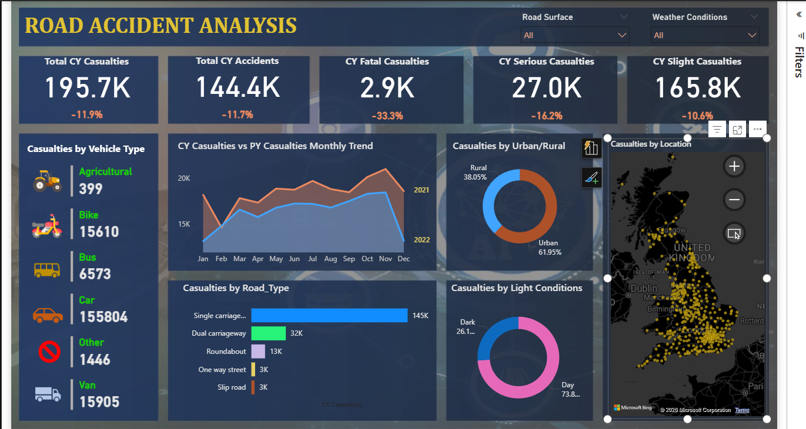

# UK Road Accident Analysis Dashboard (Power BI)

An interactive **Power BI** dashboard built on public UK road safety data to monitor accident volume, casualty severity, year-over-year (YoY) trends, and geographic hotspots across **2021 vs. 2022**.

---

## Executive KPIs (Current Year vs. Previous Year)
* **Total CY Casualties:** `195.7K` (`-11.9%` vs. PY)
* **Total CY Accidents:** `144.4K` (`-11.7%` vs. PY)
* **CY Fatal Casualties:** `2.9K` (`-33.3%` vs. PY)
* **CY Serious Casualties:** `27.0K` (`-16.2%` vs. PY)
* **CY Slight Casualties:** `165.8K` (`-10.6%` vs. PY)

---

## Key Analytical Views

### 1. Casualties by Vehicle Type
Icon-based breakdown highlighting casualty volume across vehicle categories:
* **Car:** `155,804`
* **Van:** `15,905`
* **Bike:** `15,610`
* **Bus:** `6,573`
* **Other:** `1,446`
* **Agricultural:** `399`

### 2. Monthly Trend Comparison (`2021` vs. `2022`)
Area chart comparing **CY Casualties vs. PY Casualties** across all 12 months (`Jan–Dec`), showing consistent year-over-year reductions throughout the year.

### 3. Road Type, Area & Light Conditions
* **Casualties by Road Type:** Horizontal bar chart led by **Single Carriageway (`145K`)**, followed by **Dual Carriageway (`32K`)**, **Roundabout (`13K`)**, **One Way Street (`3K`)**, and **Slip Road (`3K`)**.
* **Urban vs. Rural Split:** Donut chart showing **Urban (`61.95%`)** vs. **Rural (`38.05%`)** casualties.
* **Light Conditions:** Donut chart comparing **Day (`73.8%`)** vs. **Dark (`26.1%`)** conditions.

### 4. Geospatial Hotspot Mapping
Interactive **Bing Map** (`Casualties by Location`) plotting accident density across the United Kingdom, paired with top-level **Road Surface** and **Weather Conditions** slicers for dynamic filtering.

---

## Tech Stack
* **BI Tool:** Microsoft Power BI
* **DAX & Modeling:** YoY time-intelligence measures (`CY` vs. `PY`, `%` variance), severity segmentation, and custom icon-driven KPI cards
* **Visuals:** Area charts, donut charts, horizontal bar charts, interactive Bing Maps, and dark-theme executive layout
